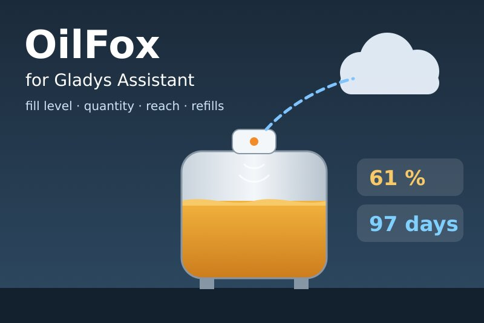
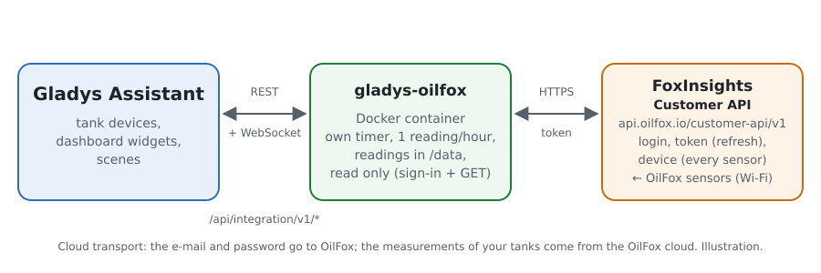
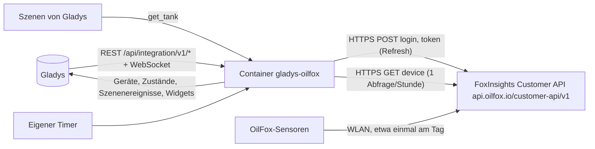
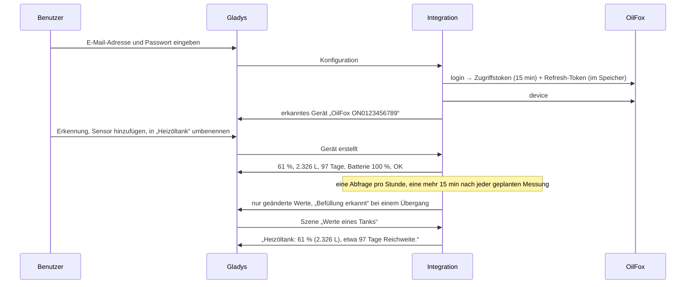

# Gladys OilFox

[English](README.md) · [Français](README.fr.md) · **Deutsch** · [Español](README.es.md)

[](LICENSE)
[](https://github.com/William-De71/gladys-oilfox/releases)
[](https://github.com/William-De71/gladys-oilfox/actions/workflows/release.yml)
[](https://gladysassistant.com)



Externe Integration von [Gladys Assistant](https://gladysassistant.com) für die Tanksensoren **OilFox** (FoxInsights GmbH: ein WLAN-Ultraschallsensor oben auf einem Heizöltank, einem Pelletsilo…), über die offizielle [FoxInsights Customer API](https://github.com/foxinsights/customer-api) mit der E-Mail-Adresse und dem Passwort deiner FoxMobile-App. Sie zeigt in Gladys Füllstand, Menge, Reichweite, Batterie und Messstatus jedes Tanks und löst Szenen bei einer neuen Messung, einer Befüllung, einem Messproblem oder einem verspäteten Sensor aus — nur lesend.

Benutzerdokumentation: [English](docs/en.md) · [Français](docs/fr.md) · [Deutsch](docs/de.md) · [Español](docs/es.md).

Nicht mit FoxInsights verbunden. **Noch nicht mit einem echten OilFox-Konto getestet**: Anfragen und Felder folgen der offiziellen Dokumentation (`docs/v1`); die Antworten auf ein unbekanntes Konto (404), ein fehlendes Feld (400), ein ungültiges Refresh-Token (401) und ein falsches Token (401) wurden live geprüft.

## Funktionen

- Jeder **OilFox-Sensor** des Kontos, von selbst gefunden (Tanks in Litern oder in kg).
- **Ein Gerät pro Sensor**: Füllstand, Menge, Reichweite, Batterie (ein ungefährer Prozentwert der Stufe, die OilFox liefert) und Messstatus.
- **7 Szenenauslöser** (neue Messung, Befüllung erkannt, Messproblem, Messung wieder in Ordnung, Messung verspätet, Messungen wieder da, Zugriff verweigert), **1 Szenenaktion** (Werte eines Tanks: Leer-Datum, Verbrauch pro Tag, ein Satz…) und **2 Dashboard-Widgets** (alle Tanks auf einen Blick, ein Tank mit 90 Tagen Füllstand).
- **Eine Abfrage pro Stunde**, die faire Nutzung von FoxInsights, dazu eine 15 Minuten nach jeder von OilFox geplanten Messung (ein OilFox misst etwa einmal am Tag).
- **Nur lesend**: eine Anmeldung, dann nur lesende Anfragen; im OilFox-Konto wird nie etwas geändert. Passwort und Tokens werden nie nach `/data` geschrieben.
- Überall vier Sprachen: Englisch, Französisch, Deutsch, Spanisch.

## Funktionsweise





Vom Konto zur Szene:



### Transport

`transports: ["cloud"]`: Alles läuft über die OilFox-Cloud (`api.oilfox.io`), die die Messungen der Sensoren per WLAN erhält. **E-Mail-Adresse und Passwort verlassen dein Netzwerk** (nur zu OilFox, zur Anmeldung); die Messungen deiner Tanks kommen von OilFox. `/data` speichert einen Fingerabdruck (SHA-256) der E-Mail-Adresse, die Sensoren der letzten Abfrage, einen Punkt pro Messung über etwa ein Jahr für das Diagramm und den Verbrauch pro Tag sowie das, was die Auslöser wissen — nie das Passwort, die E-Mail-Adresse oder ein Token.

## Geräte und Funktionen

| Gerät           | Funktionen (Kategorie / Typ)                                                                                                                                                                                                                                                      |
| --------------- | --------------------------------------------------------------------------------------------------------------------------------------------------------------------------------------------------------------------------------------------------------------------------------- |
| Eins pro Sensor | Füllstand (`level-sensor` / `liquid-level-percent`, %), Menge (`volume-sensor` / `integer`, L; oder `counter-sensor` / `integer` ohne Einheit für einen Tank in kg), Reichweite (`duration` / `integer`, Tage), Batterie (`battery` / `integer`, %), Messstatus (`text` / `text`) |

- Die API liefert keinen Namen: Ein Sensor wird als „OilFox <Hardware-ID>“ angeboten; benenne ihn in Gladys um, Widgets und Szenen verwenden diesen Namen.
- Bei einem Tank in kg (Pellets) ist die Menge ein Zähler ohne Einheit namens „Menge (kg)“: Der Kern kennt kein Kilogramm.
- Die Batterie ist für OilFox eine Stufe (FULL, GOOD, MEDIUM, WARNING, CRITICAL): Sie wird in einen ungefähren Prozentwert umgerechnet (100, 75, 50, 15, 5), damit die Batteriewarnungen von Gladys funktionieren.
- Ein Wert, den die API weglässt (kein Füllstand, wenn die Messung ein Problem hat), wird nicht veröffentlicht: Der letzte Wert bleibt. Unveränderte Werte werden alle 6 Stunden erneut gesendet, außer bei einem verspäteten Sensor (Gladys zeigt sie dann als veraltet).
- Alle Funktionen sind schreibgeschützt und behalten ihren Verlauf.
- Die External IDs beruhen auf der Hardware-ID des Sensors (`ext:…:tank:ON0123456789`).

## Szenenauslöser, Aktionen und Widgets


**Widgets**: OilFox-Tanks (eine Anzeige pro Tank mit bekanntem Füllstand, höchstens 6; eine Karte pro Tank, die Probleme zuerst, dann die verspäteten Sensoren, dann die schwachen Batterien, mit Menge, Reichweite und Alter der letzten Messung) und OilFox-Tank (ein Tank, standardmäßig der erste: Füllstandsanzeige, Menge, Reichweite, Batterie, der Füllstand der letzten 90 Tage aus den in `/data` aufbewahrten Punkten, der Messstatus, die letzte und die nächste Messung, das geschätzte Leer-Datum, der durchschnittliche Verbrauch pro Tag über 30 Tage — Abnahmen zwischen zwei Messungen, ohne Befüllungen).

**Auslöser** (ein Ereignis pro Übergang, nie bei der ersten Abfrage, nie als Folge einer Aktion; Filter: Tank):

- **neue Messung**: OilFox hat den Tank gemessen; Variablen: Füllstand, Menge, Einheit, Reichweite, Batteriestufe, Verbrauch seit der vorigen Messung, Zeitpunkt der Messung;
- **Befüllung erkannt**: Der Füllstand ist zwischen zwei Messungen um 5 Punkte oder mehr gestiegen; Variablen: Füllstand vorher und nachher, hinzugekommene Menge, Menge, Einheit;
- **Messproblem** / **Messung wieder in Ordnung**: OilFox meldet ein Problem (Noch keine Messung, Fehlerhafte Messung, Kein Füllstand erkannt, Fehlerhafte Messung (Sensor), Tankeinstellungen fehlen, Falsche Tankeinstellungen, Gemessener Abstand zu klein, Tank voll, Unplausibler Füllstand; Filter: Probleme; Variablen: Code, Bezeichnung), dann keines mehr;
- **Messung verspätet** / **Messungen wieder da**: Die von OilFox geplante Messung ist 24 Stunden überfällig (Variablen: erwarteter Zeitpunkt, Stunden Verspätung), dann wieder Messungen;
- **Zugriff verweigert**: OilFox lehnt E-Mail-Adresse, Passwort oder Tokens ab (Grund `refused`, `unknown_account` oder `token`) — einmal pro Ablehnung.

Die Werte sind Gerätefunktionen: „Füllstand unter 20 %“ ist eine Gerätebedingung von Gladys, mit deinem eigenen Schwellenwert.

**Aktion**:

- **Werte eines Tanks**: Name, Füllstand, Menge, Einheit, Reichweite, Leer-Datum (JJJJ-MM-TT), Verbrauch pro Tag (Durchschnitt über 30 Tage), Batteriestufe und ungefährer Prozentwert, Messproblem (Code und Bezeichnung), letzte und nächste Messung, verspätet oder nicht, und ein Satz (`summary`), aus der letzten Abfrage (keine Anfrage).

Absichtlich nicht gemacht: kein Schreiben (die API liest nur), keine US-Gallonen, ein Konto pro Integration.

Beispiele:

- Wenn der **Füllstand** des Heizöltanks unter 20 % fällt (Gerätebedingung) → „Zeit, Heizöl zu bestellen“ senden.
- Wenn **OilFox: Befüllung erkannt** → „{{triggerEvent.data.tank_name}}: +{{triggerEvent.data.added_quantity}} {{triggerEvent.data.unit}} geliefert“ senden.
- Jeden Montag um 8:00 → **OilFox: Werte eines Tanks** → seine `summary` senden.

## Voraussetzungen

- Gladys Assistant **5.3.0** oder neuer (Widgets und Szenen der Integrationen, Katalog-Schlüsselwörter von Gladys 5.3): Ältere Instanzen können die Integration nicht installieren.
- Ein in der **FoxMobile**-App eingerichteter OilFox-Sensor mit seinem Tank (Form und Größe): ohne sie liefert OilFox keinen Füllstand („Tankeinstellungen fehlen“).
- E-Mail-Adresse und Passwort des FoxMobile-Kontos. Nur deine eigenen Sensoren: Die Fair-Use-Regeln von FoxInsights verbieten es, Geräte anderer Personen zu überwachen.
- Internet: Die Integration spricht nur mit `api.oilfox.io`.

### Das Tempo der API

FoxInsights schreibt, dass eine stündliche Abfrage des Zustands aller eigenen Geräte als faire Nutzung gilt; darüber hinaus antwortet die API mit 429. Ein Timer prüft jede Minute, was fällig ist: eine Abfrage pro Stunde (eine Anfrage für alle Sensoren), eine weitere 15 Minuten nach jeder von OilFox geplanten Messung (`nextMeteringAt`, einmal, mindestens 15 Minuten nach der vorigen Abfrage), ein neuer Versuch 15 Minuten nach einem Fehler, eine Stunde nach einem abgelehnten Konto. Das Zugriffstoken lebt 15 Minuten und wird mit dem einmal verwendbaren Refresh-Token erneuert. Nach einem 429 wartet jede Anfrage eine Stunde (oder den Retry-After); nach einem 5xx oder ohne Antwort 10 Minuten, dann doppelt so lange bis zu 2 Stunden. Die Szenenaktion sendet nie eine Anfrage.

## Installation

- **Aus dem Store**: Integrationen → OilFox → Installieren.
- **Über die Repository-URL**: Integrationen → externe Integration → `https://github.com/William-De71/gladys-oilfox`.
- **Entwicklermodus**: `npm start` mit den von Gladys gegebenen Variablen ausführen (siehe Entwicklung).

## Konfiguration

| Feld oder Schaltfläche       | Standard    | Bedeutung                                                                                                     |
| ---------------------------- | ----------- | ------------------------------------------------------------------------------------------------------------- |
| E-Mail-Adresse               | —           | Pflicht: die E-Mail des FoxMobile-Kontos                                                                      |
| Passwort                     | —           | Pflicht, ein Geheimnis: nie wieder angezeigt, nie geloggt, nie nach `/data` geschrieben                       |
| Sprache der Texte            | automatisch | Funktionsnamen, Messstatus, Szenentexte und Fehler (automatisch: die Sprache des zuletzt angezeigten Widgets) |
| Verbindung testen / Diagnose | —           | Eine Anmeldung, die Sensoren und ihre Hardware-IDs; der Zustand in den Logs, ohne Passwort, Token und E-Mail  |

## Verwendung

1. Richte den OilFox und seinen Tank in der FoxMobile-App ein.
2. In Gladys (Integrationen → OilFox → Konfiguration): E-Mail-Adresse und Passwort eingeben; **Verbindung testen** drücken.
3. **Erkennung**, dann deine Sensoren als Geräte hinzufügen und umbenennen.
4. Die Widgets zu einem Dashboard hinzufügen, Szenen mit den Funktionen, Auslösern und der Aktion bauen.

## Entwicklung

```bash
npm install
npm test                       # node --test, ein falsches OilFox (fetch im Speicher, falsche Uhr), nie das Netzwerk
npm run lint                   # ESLint
npm run format:check           # Prettier
npx github:GladysAssistant/integration-store . --skip-image-check
scripts/build-cover.sh         # cover.jpg aus docs/assets/cover.svg
docs/illustrations/render.sh   # docs/assets/widgets.<sprache>.png
```

Lokal liest das SDK `GLADYS_HOST_API_URL`, `GLADYS_INTEGRATION_TOKEN` und `GLADYS_INTEGRATION_SELECTOR` (von Gladys im Entwicklermodus gegeben), und die Integration liest `TZ`. `DEBUG=gladys-integration-sdk` zeigt die Logs des SDK.

Die Tests decken den HTTP-Client ab (die Anmeldung, das einmal verwendbare Refresh-Token, die live gesehenen Ablehnungen, eine neue Anmeldung für ein abgelehntes Token, die Pausen, nie eine leere Antwort als leeres Konto), die Parser, die Auslöser, den Verbrauch pro Tag, die Geräte (die Felder, die der Erkennungsbildschirm verlangt, die Kategorie-/Typ-Paare des Kerns), die Widgets (`validateWidgetContent`), das Manifest, die vier Sprachen, das Release-Skript und die ganze Integration gegen das falsche Gladys des SDK und ein falsches OilFox über simulierte Tage. `test/structure.test.js` friert jeden Schlüssel ein, den Benutzer speichern.

## Release-Prozess


Jeder Merge auf `main` startet die CI und berechnet dann die Version aus den [Conventional Commits](https://www.conventionalcommits.org/) seit dem letzten Tag: `feat` → Minor, `fix` / `perf` → Patch, `!` oder `BREAKING CHANGE` → Major (ein Minor unter 1.0.0); `docs`, `chore`, `ci`, `test`, `style`, `refactor`, `build` allein veröffentlichen nichts. Der Changelog-Abschnitt wird erzeugt, der Tag gepusht, das Multi-Architektur-Image gebaut, dann erhält `main` den Release-Commit, die GitHub Release wird erstellt und ein letzter Job prüft das öffentliche Image, den Store-Validator und das Topic.

- Der Titel des Pull Requests wird zum Squash-Commit, dann zur Changelog-Zeile: Schreib ihn auf Englisch, für den Benutzer (`pr-title.yml` prüft ihn). Bearbeite `CHANGELOG.md` nie von Hand.
- 1.0.0 ist eine Entscheidung: Actions → Release → Run workflow mit `release-as: 1.0.0`. `dry-run` zeigt Version und Notizen, ohne zu veröffentlichen.
- **Geschützter Branch**: Das Release pusht seinen Commit mit `GITHUB_TOKEN` auf `main`. Das Ruleset `protect-main` (kein Löschen, kein Force-Push) lässt ihn durch; eine strengere Regel (Pull Request Pflicht, Status Checks) bräuchte GitHub Actions in der Bypass-Liste oder eine GitHub App.
- Nach dem ersten Release das `ghcr.io`-Paket öffentlich machen (Package settings → Change visibility), sonst kann Gladys es nicht laden.

## Fehlerbehebung

Siehe [docs/de.md](docs/de.md#fehlerbehebung). Melde Probleme mit den Versionen von Gladys und der Integration, der Meldung von **Verbindung testen** und dem Ergebnis von **Diagnose** (in den Logs der Integration). Füge nie dein Passwort ein.

## Mitwirken

Issues und Pull Requests sind willkommen. Führe `npm run format:check && npm run lint && npm test` aus, bevor du einen Pull Request öffnest, und lass jede External ID und jeden gespeicherten Schlüssel unverändert (siehe [CLAUDE.md](CLAUDE.md)).

## Sicherheit

Siehe [SECURITY.md](SECURITY.md): Melde Schwachstellen vertraulich. Das Passwort ist ein `secret`-Feld: nie geloggt, nie nach `/data` geschrieben, nur an `api.oilfox.io` gesendet, zur Anmeldung. Zugriffs- und Refresh-Token bleiben im Speicher, werden nie geloggt und nur an `api.oilfox.io` gesendet. `/data/oilfox.json` wird mit Modus 0600 geschrieben.

## Kommende Screenshots

Die Bilder oben sind Illustrationen, keine Screenshots. Echte Screenshots kommen nach `docs/assets/screenshots/` (PNG, 1280 × 800): `configuration.png`, `discovery.png` (die angebotenen Sensoren), `device.png` (ein Tank mit seinen Funktionen), `scene-refill.png` (eine Szene mit dem Auslöser „Befüllung erkannt“), `dashboard.png` (die beiden Widgets mit echten Tanks).

## Lizenz

[Apache-Lizenz 2.0](LICENSE) — siehe auch [NOTICE](NOTICE). OilFox ist eine Marke ihres Inhabers. Danke an die Dokumentation und das SDK von Gladys und an FoxInsights für die öffentliche Dokumentation seiner Customer API (ihr Beispielcode unter der SSPL wurde nicht verwendet).
