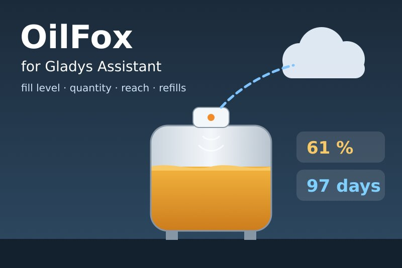
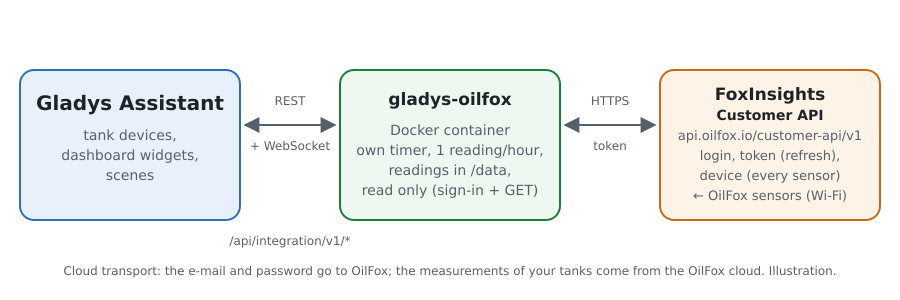
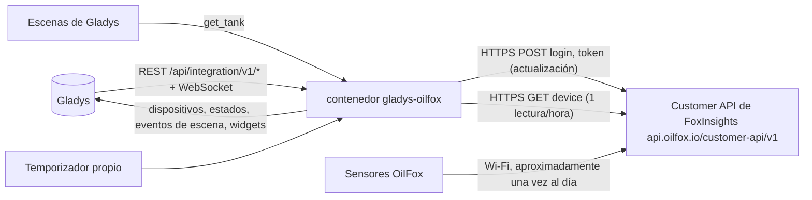
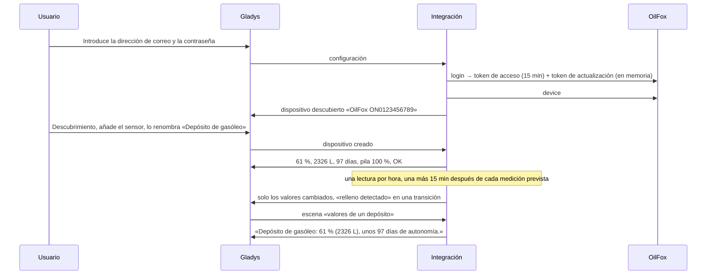

# Gladys OilFox

[English](README.md) · [Français](README.fr.md) · [Deutsch](README.de.md) · **Español**

[](LICENSE)
[](https://github.com/William-De71/gladys-oilfox/releases)
[](https://github.com/William-De71/gladys-oilfox/actions/workflows/release.yml)
[](https://gladysassistant.com)



Integración externa de [Gladys Assistant](https://gladysassistant.com) para los sensores de depósito **OilFox** (FoxInsights GmbH: un sensor Wi-Fi de ultrasonidos encima de un depósito de gasóleo, un silo de pellets…), a través de la [Customer API oficial de FoxInsights](https://github.com/foxinsights/customer-api) y la dirección de correo y la contraseña de su aplicación FoxMobile. Muestra en Gladys el nivel de llenado, la cantidad, la autonomía, la pila y el estado de la medición de cada depósito, y lanza escenas con cada nueva medición, relleno, problema de medición o sensor con retraso — solo lectura.

Documentación de usuario: [English](docs/en.md) · [Français](docs/fr.md) · [Deutsch](docs/de.md) · [Español](docs/es.md).

No afiliada a FoxInsights. **Todavía no probada con una cuenta OilFox real**: las peticiones y los campos siguen la documentación oficial (`docs/v1`); las respuestas a una cuenta desconocida (404), a un campo ausente (400), a un token de actualización no válido (401) y a un token erróneo (401) se comprobaron en directo.

## Funciones

- Cada **sensor OilFox** de la cuenta, encontrado solo (depósitos en litros o en kg).
- **Un dispositivo por sensor**: nivel de llenado, cantidad, autonomía, pila (un porcentaje aproximado del nivel que da OilFox) y estado de la medición.
- **7 disparadores de escena** (nueva medición, relleno detectado, problema de medición, medición correcta de nuevo, medición con retraso, mediciones de vuelta, acceso denegado), **1 acción de escena** (valores de un depósito: día en que quedará vacío, consumo por día, una frase…) y **2 widgets de panel** (todos los depósitos de un vistazo, un depósito con 90 días de nivel).
- **Una lectura por hora**, el uso razonable de FoxInsights, más una 15 minutos después de cada medición prevista por OilFox (un OilFox mide aproximadamente una vez al día).
- **Solo lectura**: un inicio de sesión y luego solo peticiones de lectura; nunca se modifica nada en la cuenta OilFox. La contraseña y los tokens nunca se escriben en `/data`.
- Cuatro idiomas en todas partes: inglés, francés, alemán, español.

## Cómo funciona





De la cuenta a una escena:



### Transporte

`transports: ["cloud"]`: todo pasa por la nube OilFox (`api.oilfox.io`), que recibe las mediciones de los sensores por Wi-Fi. **La dirección de correo y la contraseña salen de su red** (solo hacia OilFox, para iniciar sesión); las mediciones de sus depósitos vienen de OilFox. `/data` guarda una huella (SHA-256) de la dirección de correo, los sensores de la última lectura, un punto por medición durante aproximadamente un año para el gráfico y el consumo por día, y lo que saben los disparadores — nunca la contraseña, la dirección de correo ni un token.

## Dispositivos y funciones

| Dispositivo    | Funciones (categoría / tipo)                                                                                                                                                                                                                                                                   |
| -------------- | ---------------------------------------------------------------------------------------------------------------------------------------------------------------------------------------------------------------------------------------------------------------------------------------------- |
| Uno por sensor | Nivel de llenado (`level-sensor` / `liquid-level-percent`, %), cantidad (`volume-sensor` / `integer`, L; o `counter-sensor` / `integer` sin unidad para un depósito en kg), autonomía (`duration` / `integer`, días), pila (`battery` / `integer`, %), estado de la medición (`text` / `text`) |

- La API no da ningún nombre: un sensor se ofrece como «OilFox <identificador de hardware>»; cámbiele el nombre en Gladys, los widgets y las escenas usan ese nombre.
- Para un depósito en kg (pellets), la cantidad es un contador sin unidad llamado «Cantidad (kg)»: el núcleo no tiene kilogramo.
- La pila es un nivel para OilFox (FULL, GOOD, MEDIUM, WARNING, CRITICAL): se convierte en un porcentaje aproximado (100, 75, 50, 15, 5) para que funcionen las alertas de pila de Gladys.
- Un valor que la API omite (ningún nivel cuando la medición tiene un problema) no se publica: se queda el último valor. Los valores sin cambios se vuelven a enviar cada 6 horas, salvo para un sensor con retraso (Gladys los muestra entonces como desactualizados).
- Todas las funciones son de solo lectura y guardan su historial.
- Los external ids se basan en el identificador de hardware del sensor (`ext:…:tank:ON0123456789`).

## Disparadores, acciones de escena y widgets


**Widgets**: Depósitos OilFox (un indicador por depósito cuyo nivel se conoce, 6 como máximo; una tarjeta por depósito, los problemas primero, luego los sensores con retraso, luego las pilas bajas, con la cantidad, la autonomía y la antigüedad de la última medición) y Depósito OilFox (un depósito, el primero por defecto: indicador del nivel, cantidad, autonomía, pila, el nivel de los últimos 90 días a partir de los puntos guardados en `/data`, el estado de la medición, la última y la próxima medición, el día estimado en que quedará vacío, el consumo medio por día en 30 días — bajadas entre dos mediciones, sin los rellenos).

**Disparadores** (un evento por transición, nunca en la primera lectura, nunca como resultado de una acción; filtro: depósito):

- **nueva medición**: OilFox midió el depósito; variables: nivel, cantidad, unidad, autonomía, nivel de pila, consumo desde la medición anterior, hora de la medición;
- **relleno detectado**: el nivel subió 5 puntos o más entre dos mediciones; variables: nivel antes y después, cantidad añadida, cantidad, unidad;
- **problema de medición** / **medición correcta de nuevo**: OilFox señala un problema (Todavía sin medición, Medición incorrecta, Ningún nivel detectado, Medición defectuosa, Faltan los ajustes del depósito, Ajustes del depósito incorrectos, Distancia medida demasiado corta, Depósito lleno, Nivel calculado poco plausible; filtro: problemas; variables: código, etiqueta), luego ninguno;
- **medición con retraso** / **mediciones de vuelta**: la medición prevista por OilFox lleva 24 horas de retraso (variables: hora esperada, horas de retraso), luego de nuevo mediciones;
- **acceso denegado**: OilFox rechaza la dirección de correo, la contraseña o los tokens (motivo `refused`, `unknown_account` o `token`) — una vez por rechazo.

Los valores son funciones de dispositivo: «nivel por debajo del 20 %» es una condición de dispositivo de Gladys, con su propio umbral.

**Acción**:

- **valores de un depósito**: nombre, nivel, cantidad, unidad, autonomía, día en que quedará vacío (AAAA-MM-DD), consumo por día (media de 30 días), nivel y porcentaje aproximado de la pila, problema de medición (código y etiqueta), última y próxima medición, con retraso o no, y una frase (`summary`), de la última lectura (sin petición).

No hecho, a propósito: ninguna escritura (la API solo lee), sin galones estadounidenses, una sola cuenta por integración.

Ejemplos:

- Cuando el **Nivel de llenado** del depósito de gasóleo baja del 20 % (condición de dispositivo) → enviar «Es hora de pedir gasóleo».
- Cuando **OilFox: relleno detectado** → enviar «{{triggerEvent.data.tank_name}}: +{{triggerEvent.data.added_quantity}} {{triggerEvent.data.unit}} entregados».
- Cada lunes a las 8:00 → **OilFox: valores de un depósito** → enviar su `summary`.

## Requisitos

- Gladys Assistant **5.3.0** o posterior (widgets y escenas de las integraciones, palabras clave del catálogo de Gladys 5.3): las instancias más antiguas no pueden instalar la integración.
- Un sensor OilFox configurado en la aplicación **FoxMobile**, con su depósito (forma y tamaño): sin ellos OilFox no da ningún nivel («Faltan los ajustes del depósito»).
- La dirección de correo y la contraseña de la cuenta FoxMobile. Solo sus propios sensores: la política de uso razonable de FoxInsights no permite vigilar los dispositivos de otras personas.
- Internet: la integración solo habla con `api.oilfox.io`.

### El ritmo de la API

FoxInsights indica que leer el estado de todos sus dispositivos cada hora se considera uso razonable; más allá, la API responde 429. Un temporizador comprueba cada minuto lo que toca: una lectura por hora (una sola petición para todos los sensores), una más 15 minutos después de cada medición prevista por OilFox (`nextMeteringAt`, una vez, al menos 15 minutos después de la lectura anterior), un nuevo intento 15 minutos después de un fallo, una hora después de una cuenta rechazada. El token de acceso dura 15 minutos y se renueva con el token de actualización de un solo uso. Tras un 429, todas las peticiones esperan una hora (o el Retry-After); tras un 5xx o sin respuesta, 10 minutos, luego el doble hasta 2 horas. La acción de escena nunca envía una petición.

## Instalación

- **Desde la tienda**: Integraciones → OilFox → Instalar.
- **Desde la URL del repositorio**: Integraciones → integración externa → `https://github.com/William-De71/gladys-oilfox`.
- **Modo desarrollador**: ejecute `npm start` con las variables que da Gladys (vea Desarrollo).

## Configuración

| Campo o botón                    | Por defecto | Significado                                                                                                             |
| -------------------------------- | ----------- | ----------------------------------------------------------------------------------------------------------------------- |
| Dirección de correo              | —           | Obligatorio: el correo de la cuenta FoxMobile                                                                           |
| Contraseña                       | —           | Obligatorio, un secreto: nunca se vuelve a mostrar, nunca se registra, nunca se escribe en `/data`                      |
| Idioma de los textos             | automático  | Nombres de las funciones, estado de la medición, textos de las escenas y errores (automático: idioma del último widget) |
| Probar la conexión / Diagnóstico | —           | Un inicio de sesión, los sensores y sus identificadores; el estado en los registros, sin contraseña, token ni correo    |

## Uso

1. Configure el OilFox y su depósito en la aplicación FoxMobile.
2. En Gladys (Integraciones → OilFox → Configuración): introduzca la dirección de correo y la contraseña; pulse **Probar la conexión**.
3. **Descubrimiento**, luego añada sus sensores como dispositivos y cámbieles el nombre.
4. Añada los widgets a un panel, cree escenas con las funciones, los disparadores y la acción.

## Desarrollo

```bash
npm install
npm test                       # node --test, un OilFox falso (fetch en memoria, reloj falso), nunca la red
npm run lint                   # ESLint
npm run format:check           # Prettier
npx github:GladysAssistant/integration-store . --skip-image-check
scripts/build-cover.sh         # cover.jpg desde docs/assets/cover.svg
docs/illustrations/render.sh   # docs/assets/widgets.<idioma>.png
```

En local, el SDK lee `GLADYS_HOST_API_URL`, `GLADYS_INTEGRATION_TOKEN` y `GLADYS_INTEGRATION_SELECTOR` (dados por Gladys en modo desarrollador), y la integración lee `TZ`. `DEBUG=gladys-integration-sdk` muestra los registros del SDK.

Las pruebas cubren el cliente HTTP (el inicio de sesión, el token de actualización de un solo uso, los rechazos vistos en directo, un nuevo inicio de sesión para un token rechazado, las pausas, nunca una respuesta vacía tomada por una cuenta vacía), los analizadores, los disparadores, el consumo por día, los dispositivos (los campos que exige la pantalla de descubrimiento, los pares categoría / tipo del núcleo), los widgets (`validateWidgetContent`), el manifiesto, los cuatro idiomas, el script de publicación, y toda la integración frente al Gladys falso del SDK y un OilFox falso durante días simulados. `test/structure.test.js` congela cada clave que guardan los usuarios.

## Proceso de publicación


Cada fusión en `main` lanza la CI y luego calcula la versión a partir de los [Conventional Commits](https://www.conventionalcommits.org/) desde la última etiqueta: `feat` → menor, `fix` / `perf` → parche, `!` o `BREAKING CHANGE` → mayor (una menor por debajo de 1.0.0); `docs`, `chore`, `ci`, `test`, `style`, `refactor`, `build` solos no publican nada. Se genera la sección del changelog, se sube la etiqueta, se construye la imagen multiarquitectura, luego `main` recibe el commit de publicación, se crea la GitHub Release y un último job comprueba la imagen pública, el validador de la tienda y el topic.

- El título de la pull request se convierte en el commit squash y luego en la línea del changelog: escríbalo en inglés, para el usuario (`pr-title.yml` lo comprueba). Nunca edite `CHANGELOG.md` a mano.
- La 1.0.0 es una decisión: Actions → Release → Run workflow con `release-as: 1.0.0`. `dry-run` muestra la versión y las notas sin publicar.
- **Rama protegida**: la publicación sube su commit a `main` con `GITHUB_TOKEN`. El ruleset `protect-main` (sin borrado, sin force-push) lo deja pasar; una regla más estricta (pull request obligatoria, status checks) necesitaría GitHub Actions en la lista de excepciones, o una GitHub App.
- Tras la primera publicación, haga público el paquete `ghcr.io` (Package settings → Change visibility), o Gladys no podrá descargarlo.

## Solución de problemas

Vea [docs/es.md](docs/es.md#solución-de-problemas). Informe de los problemas con las versiones de Gladys y de la integración, el mensaje de **Probar la conexión** y el resultado de **Diagnóstico** (en los registros de la integración). Nunca pegue su contraseña.

## Contribuir

Las incidencias y pull requests son bienvenidas. Ejecute `npm run format:check && npm run lint && npm test` antes de abrir una pull request, y mantenga sin cambios cada external id y cada clave guardada (vea [CLAUDE.md](CLAUDE.md)).

## Seguridad

Vea [SECURITY.md](SECURITY.md): informe de las vulnerabilidades en privado. La contraseña es un campo `secret`: nunca se registra, nunca se escribe en `/data`, solo se envía a `api.oilfox.io`, para iniciar sesión. Los tokens de acceso y de actualización se quedan en memoria, nunca se registran y solo se envían a `api.oilfox.io`. `/data/oilfox.json` se escribe con modo 0600.

## Capturas pendientes

Las imágenes de arriba son ilustraciones, no capturas de pantalla. Las capturas reales irán en `docs/assets/screenshots/` (PNG, 1280 × 800): `configuration.png`, `discovery.png` (los sensores ofrecidos), `device.png` (un depósito con sus funciones), `scene-refill.png` (una escena con el disparador «relleno detectado»), `dashboard.png` (los dos widgets con depósitos reales).

## Licencia

[Licencia Apache 2.0](LICENSE) — vea también [NOTICE](NOTICE). OilFox es una marca de su propietario. Gracias a la documentación y al SDK de Gladys, y a FoxInsights por la documentación pública de su Customer API (su código de ejemplo, bajo licencia SSPL, no se ha utilizado).
