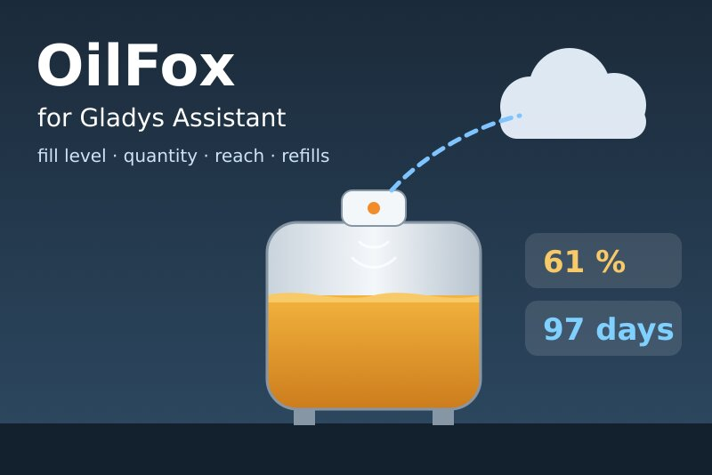
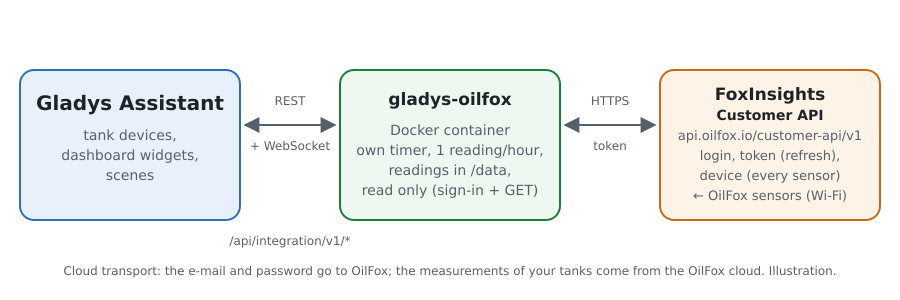
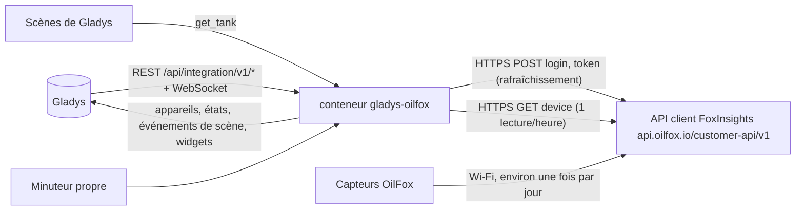
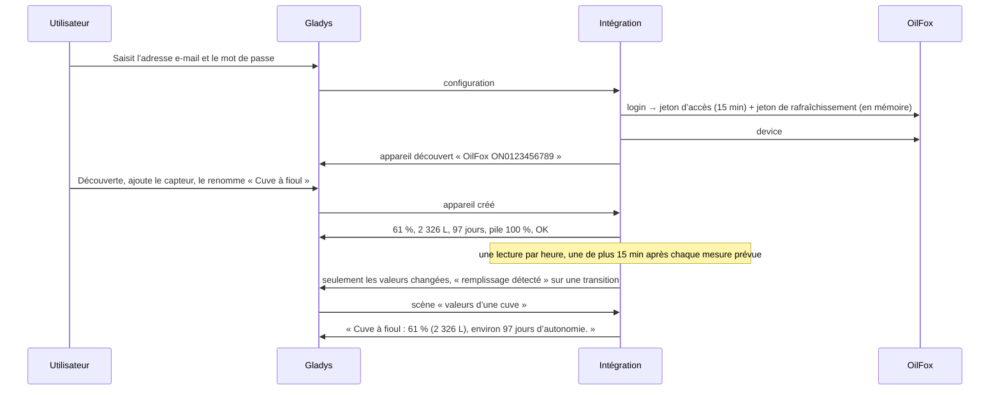

# Gladys OilFox

[English](README.md) · **Français** · [Deutsch](README.de.md) · [Español](README.es.md)

[](LICENSE)
[](https://github.com/William-De71/gladys-oilfox/releases)
[](https://github.com/William-De71/gladys-oilfox/actions/workflows/release.yml)
[](https://gladysassistant.com)



Intégration externe de [Gladys Assistant](https://gladysassistant.com) pour les capteurs de cuve **OilFox** (FoxInsights GmbH : un capteur Wi-Fi à ultrasons posé sur une cuve à fioul, un silo à granulés…), via l’[API client officielle de FoxInsights](https://github.com/foxinsights/customer-api) et l’adresse e-mail et le mot de passe de votre application FoxMobile. Elle affiche dans Gladys le niveau de remplissage, la quantité, l’autonomie, la pile et l’état de la mesure de chaque cuve, et déclenche des scènes à chaque nouvelle mesure, remplissage, problème de mesure ou capteur en retard — en lecture seule.

Documentation utilisateur : [English](docs/en.md) · [Français](docs/fr.md) · [Deutsch](docs/de.md) · [Español](docs/es.md).

Non affiliée à FoxInsights. **Pas encore testée avec un vrai compte OilFox** : les requêtes et les champs suivent la documentation officielle (`docs/v1`) ; les réponses à un compte inconnu (404), à un champ manquant (400), à un jeton de rafraîchissement invalide (401) et à un mauvais jeton (401) ont été vérifiées en direct.

## Fonctionnalités

- Chaque **capteur OilFox** du compte, trouvé tout seul (cuves en litres ou en kg).
- **Un appareil par capteur** : niveau de remplissage, quantité, autonomie, pile (un pourcentage approximatif du niveau donné par OilFox) et état de la mesure.
- **7 déclencheurs de scène** (nouvelle mesure, remplissage détecté, problème de mesure, mesure de nouveau correcte, mesure en retard, mesures de retour, accès refusé), **1 action de scène** (valeurs d’une cuve : date où elle sera vide, consommation par jour, une phrase…) et **2 widgets** (toutes les cuves d’un coup d’œil, une cuve avec 90 jours de niveau).
- **Une lecture par heure**, l’usage raisonnable de FoxInsights, plus une 15 minutes après chaque mesure prévue par OilFox (un OilFox mesure environ une fois par jour).
- **Lecture seule** : une connexion, puis uniquement des requêtes de lecture ; rien n’est jamais modifié dans le compte OilFox. Le mot de passe et les jetons ne sont jamais écrits dans `/data`.
- Quatre langues partout : anglais, français, allemand, espagnol.

## Fonctionnement





Du compte à une scène :



### Transport

`transports: ["cloud"]` : tout passe par le cloud OilFox (`api.oilfox.io`), qui reçoit les mesures des capteurs en Wi-Fi. **L’adresse e-mail et le mot de passe quittent votre réseau** (vers OilFox seulement, pour la connexion) ; les mesures de vos cuves viennent d’OilFox. `/data` garde une empreinte (SHA-256) de l’adresse e-mail, les capteurs de la dernière lecture, un point par mesure sur environ un an pour la courbe et la consommation par jour, et ce que savent les déclencheurs — jamais le mot de passe, ni l’adresse e-mail, ni un jeton.

## Appareils et fonctionnalités

| Appareil       | Fonctionnalités (catégorie / type)                                                                                                                                                                                                                                                              |
| -------------- | ----------------------------------------------------------------------------------------------------------------------------------------------------------------------------------------------------------------------------------------------------------------------------------------------- |
| Un par capteur | Niveau de remplissage (`level-sensor` / `liquid-level-percent`, %), quantité (`volume-sensor` / `integer`, L ; ou `counter-sensor` / `integer` sans unité pour une cuve en kg), autonomie (`duration` / `integer`, jours), pile (`battery` / `integer`, %), état de la mesure (`text` / `text`) |

- L’API ne donne pas de nom : un capteur est proposé sous le nom « OilFox <identifiant matériel> » ; renommez-le dans Gladys, les widgets et les scènes utilisent ce nom.
- Pour une cuve en kg (granulés), la quantité est un compteur sans unité nommé « Quantité (kg) » : le cœur n’a pas de kilogramme.
- La pile est un niveau pour OilFox (FULL, GOOD, MEDIUM, WARNING, CRITICAL) : il est traduit en pourcentage approximatif (100, 75, 50, 15, 5) pour que les alertes de pile de Gladys fonctionnent.
- Une valeur que l’API ne donne pas (aucun niveau quand la mesure a un problème) n’est pas publiée : la dernière valeur reste. Les valeurs inchangées sont renvoyées toutes les 6 heures, sauf pour un capteur en retard (Gladys les affiche alors comme périmées).
- Toutes les fonctionnalités sont en lecture seule et gardent leur historique.
- Les external ids reposent sur l’identifiant matériel du capteur (`ext:…:tank:ON0123456789`).

## Déclencheurs, actions de scène et widgets


**Widgets** : Cuves OilFox (une jauge par cuve dont le niveau est connu, 6 au plus ; une carte par cuve, les problèmes d’abord, puis les capteurs en retard, puis les piles faibles, avec la quantité, l’autonomie et l’âge de la dernière mesure) et Cuve OilFox (une cuve, la première par défaut : jauge du niveau, quantité, autonomie, pile, le niveau des 90 derniers jours depuis les points gardés dans `/data`, l’état de la mesure, la dernière et la prochaine mesure, la date estimée où la cuve sera vide, la consommation moyenne par jour sur 30 jours — les baisses entre deux mesures, sans les remplissages).

**Déclencheurs** (un événement par transition, jamais à la première lecture, jamais à la suite d’une action ; filtre : cuve) :

- **nouvelle mesure** : OilFox a mesuré la cuve ; variables : niveau, quantité, unité, autonomie, niveau de pile, consommation depuis la mesure précédente, heure de la mesure ;
- **remplissage détecté** : le niveau a monté d’au moins 5 points entre deux mesures ; variables : niveau avant et après, quantité ajoutée, quantité, unité ;
- **problème de mesure** / **mesure de nouveau correcte** : OilFox signale un problème (Pas encore de mesure, Mesure incorrecte, Aucun niveau détecté, Mesure défectueuse, Réglages de la cuve manquants, Réglages de la cuve incorrects, Distance mesurée trop courte, Cuve pleine, Niveau calculé peu plausible ; filtre : problèmes ; variables : code, libellé), puis plus aucun ;
- **mesure en retard** / **mesures de retour** : la mesure prévue par OilFox a 24 heures de retard (variables : heure attendue, heures de retard), puis de nouveau des mesures ;
- **accès refusé** : OilFox refuse l’adresse e-mail, le mot de passe ou les jetons (raison `refused`, `unknown_account` ou `token`) — une fois par refus.

Les valeurs sont des fonctionnalités d’appareil : « niveau sous 20 % » est une condition d’appareil de Gladys, avec votre propre seuil.

**Action** :

- **valeurs d’une cuve** : nom, niveau, quantité, unité, autonomie, date où elle sera vide (AAAA-MM-JJ), consommation par jour (moyenne sur 30 jours), niveau et pourcentage approximatif de la pile, problème de mesure (code et libellé), dernière et prochaine mesure, en retard ou non, et une phrase (`summary`), depuis la dernière lecture (sans requête).

Pas fait, volontairement : aucune écriture (l’API ne fait que lire), pas de gallons US, un seul compte par intégration.

Exemples :

- Quand le **Niveau de remplissage** de la cuve à fioul passe sous 20 % (condition d’appareil) → envoyer « Il est temps de commander du fioul ».
- Quand **OilFox : remplissage détecté** → envoyer « {{triggerEvent.data.tank_name}} : +{{triggerEvent.data.added_quantity}} {{triggerEvent.data.unit}} livrés ».
- Chaque lundi à 8 h → **OilFox : valeurs d’une cuve** → envoyer son `summary`.

## Prérequis

- Gladys Assistant **5.3.0** ou plus récent (widgets et scènes des intégrations, mots-clés du catalogue de Gladys 5.3) : les instances plus anciennes ne peuvent pas installer l’intégration.
- Un capteur OilFox installé dans l’application **FoxMobile**, avec sa cuve (forme et dimensions) : sans elles, OilFox ne donne aucun niveau (« Réglages de la cuve manquants »).
- L’adresse e-mail et le mot de passe du compte FoxMobile. Vos propres capteurs seulement : la politique d’usage raisonnable de FoxInsights interdit de surveiller les appareils d’autres personnes.
- Internet : l’intégration ne parle qu’à `api.oilfox.io`.

### Le rythme de l’API

FoxInsights écrit que lire l’état de tous ses appareils toutes les heures est un usage raisonnable ; au-delà, l’API répond 429. Un minuteur vérifie chaque minute ce qui est dû : une lecture par heure (une seule requête pour tous les capteurs), une de plus 15 minutes après chaque mesure prévue par OilFox (`nextMeteringAt`, une fois, au moins 15 minutes après la lecture précédente), un nouvel essai 15 minutes après un échec, une heure après un compte refusé. Le jeton d’accès vit 15 minutes et se renouvelle avec le jeton de rafraîchissement à usage unique. Après un 429, toutes les requêtes attendent une heure (ou le Retry-After) ; après un 5xx ou une absence de réponse, 10 minutes, puis le double jusqu’à 2 heures. L’action de scène n’envoie jamais de requête.

## Installation

- **Depuis le store** : Intégrations → OilFox → Installer.
- **Depuis l’URL du dépôt** : Intégrations → intégration externe → `https://github.com/William-De71/gladys-oilfox`.
- **Mode développeur** : lancez `npm start` avec les variables données par Gladys (voir Développement).

## Configuration

| Champ ou bouton                  | Par défaut  | Signification                                                                                                      |
| -------------------------------- | ----------- | ------------------------------------------------------------------------------------------------------------------ |
| Adresse e-mail                   | —           | Obligatoire : l’e-mail du compte FoxMobile                                                                         |
| Mot de passe                     | —           | Obligatoire, un secret : jamais réaffiché, jamais journalisé, jamais écrit dans `/data`                            |
| Langue des textes                | automatique | Noms des fonctionnalités, état de la mesure, textes des scènes et erreurs (automatique : langue du dernier widget) |
| Tester la connexion / Diagnostic | —           | Une connexion, les capteurs et leurs identifiants ; l’état dans les journaux, sans mot de passe, jeton ni e-mail   |

## Utilisation

1. Installez l’OilFox et sa cuve dans l’application FoxMobile.
2. Dans Gladys (Intégrations → OilFox → Configuration) : saisissez l’adresse e-mail et le mot de passe ; cliquez sur **Tester la connexion**.
3. **Découverte**, puis ajoutez vos capteurs comme appareils et renommez-les.
4. Ajoutez les widgets à un tableau de bord, construisez des scènes avec les fonctionnalités, les déclencheurs et l’action.

## Développement

```bash
npm install
npm test                       # node --test, un faux OilFox (fetch en mémoire, fausse horloge), jamais le réseau
npm run lint                   # ESLint
npm run format:check           # Prettier
npx github:GladysAssistant/integration-store . --skip-image-check
scripts/build-cover.sh         # cover.jpg depuis docs/assets/cover.svg
docs/illustrations/render.sh   # docs/assets/widgets.<langue>.png
```

En local, le SDK lit `GLADYS_HOST_API_URL`, `GLADYS_INTEGRATION_TOKEN` et `GLADYS_INTEGRATION_SELECTOR` (donnés par Gladys en mode développeur), et l’intégration lit `TZ`. `DEBUG=gladys-integration-sdk` affiche les journaux du SDK.

Les tests couvrent le client HTTP (la connexion, le jeton de rafraîchissement à usage unique, les refus vus en direct, une nouvelle connexion pour un jeton refusé, les pauses, jamais une réponse vide prise pour un compte vide), les lecteurs de réponses, les déclencheurs, la consommation par jour, les appareils (les champs qu’exige l’écran de découverte, les couples catégorie / type du cœur), les widgets (`validateWidgetContent`), le manifeste, les quatre langues, le script de release, et toute l’intégration face au faux Gladys du SDK et à un faux OilFox sur plusieurs jours simulés. `test/structure.test.js` fige chaque clé que les utilisateurs enregistrent.

## Processus de release


Chaque fusion sur `main` lance la CI, puis calcule la version depuis les [Conventional Commits](https://www.conventionalcommits.org/) depuis le dernier tag : `feat` → mineure, `fix` / `perf` → correctif, `!` ou `BREAKING CHANGE` → majeure (une mineure sous 1.0.0) ; `docs`, `chore`, `ci`, `test`, `style`, `refactor`, `build` seuls ne publient rien. La section du changelog est générée, le tag poussé, l’image multi-architecture construite, puis `main` reçoit le commit de release, la GitHub Release est créée et un dernier job vérifie l’image publique, le validateur du store et le topic.

- Le titre de la pull request devient le commit squash, puis la ligne du changelog : écrivez-le en anglais, pour l’utilisateur (`pr-title.yml` le vérifie). Ne modifiez jamais `CHANGELOG.md` à la main.
- La 1.0.0 est une décision : Actions → Release → Run workflow avec `release-as: 1.0.0`. `dry-run` montre la version et les notes sans rien publier.
- **Branche protégée** : la release pousse son commit sur `main` avec `GITHUB_TOKEN`. Le ruleset `protect-main` (ni suppression, ni force-push) le laisse passer ; une règle plus stricte (pull request obligatoire, status checks) demanderait d’ajouter GitHub Actions aux contournements, ou une GitHub App.
- Après la première release, rendez public le paquet `ghcr.io` (Package settings → Change visibility), sinon Gladys ne peut pas le télécharger.

## Dépannage

Voir [docs/fr.md](docs/fr.md#dépannage). Signalez les problèmes avec les versions de Gladys et de l’intégration, le message de **Tester la connexion** et le résultat de **Diagnostic** (dans les journaux de l’intégration). Ne collez jamais votre mot de passe.

## Contribuer

Les tickets et pull requests sont les bienvenus. Lancez `npm run format:check && npm run lint && npm test` avant d’ouvrir une pull request, et gardez inchangés chaque external id et chaque clé enregistrée (voir [CLAUDE.md](CLAUDE.md)).

## Sécurité

Voir [SECURITY.md](SECURITY.md) : signalez les vulnérabilités en privé. Le mot de passe est un champ `secret` : jamais journalisé, jamais écrit dans `/data`, envoyé uniquement à `api.oilfox.io`, pour la connexion. Les jetons d’accès et de rafraîchissement restent en mémoire, ne sont jamais journalisés et ne sont envoyés qu’à `api.oilfox.io`. `/data/oilfox.json` est écrit en mode 0600.

## Captures à venir

Les images ci-dessus sont des illustrations, pas des captures d’écran. Les vraies captures iront dans `docs/assets/screenshots/` (PNG, 1280 × 800) : `configuration.png`, `discovery.png` (les capteurs proposés), `device.png` (une cuve avec ses fonctionnalités), `scene-refill.png` (une scène sur le déclencheur « remplissage détecté »), `dashboard.png` (les deux widgets avec de vraies cuves).

## Licence

[Licence Apache 2.0](LICENSE) — voir aussi [NOTICE](NOTICE). OilFox est une marque de son propriétaire. Merci à la documentation et au SDK de Gladys, et à FoxInsights pour la documentation publique de son API client (son code d’exemple, sous licence SSPL, n’a pas été utilisé).
