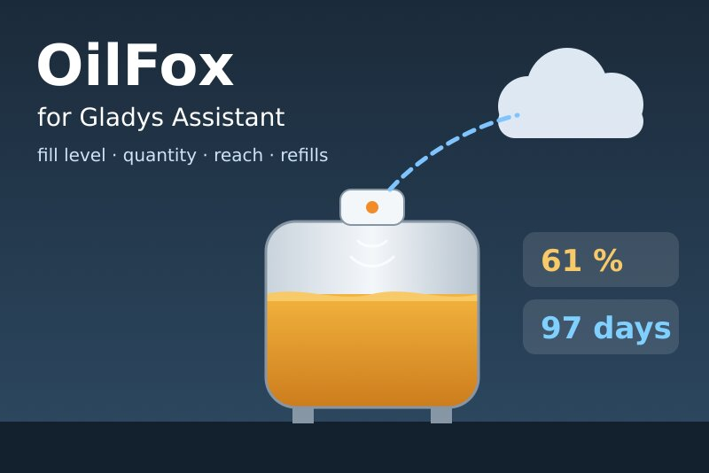
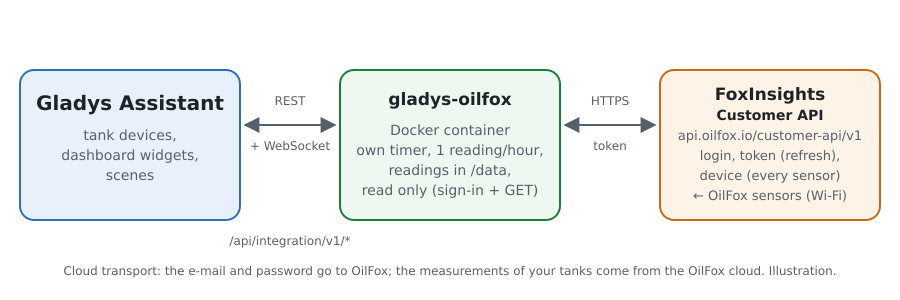
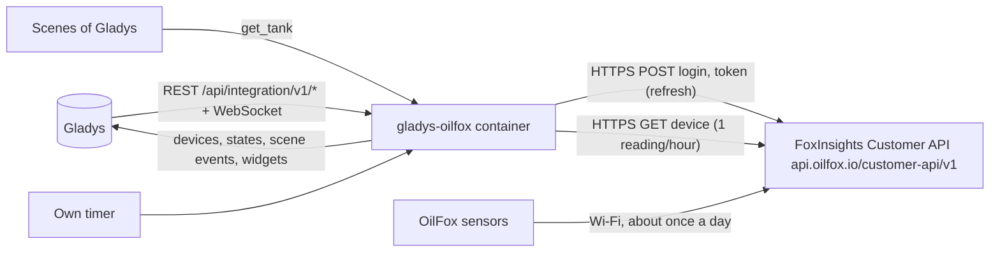
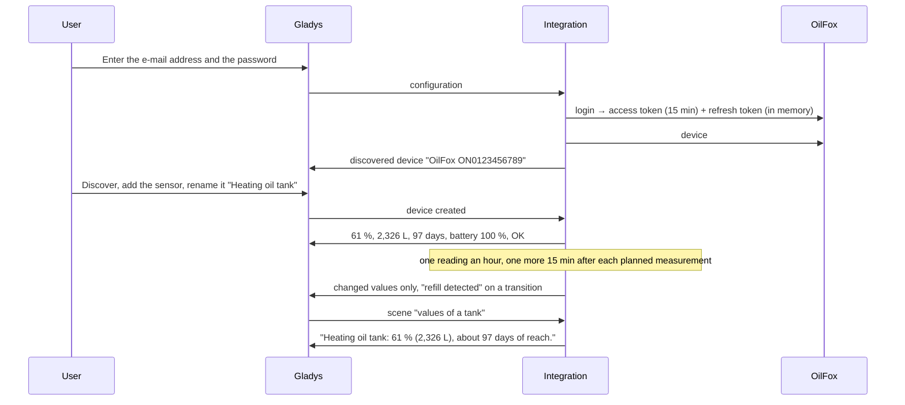

# Gladys OilFox

**English** · [Français](README.fr.md) · [Deutsch](README.de.md) · [Español](README.es.md)

[](LICENSE)
[](https://github.com/William-De71/gladys-oilfox/releases)
[](https://github.com/William-De71/gladys-oilfox/actions/workflows/release.yml)
[](https://gladysassistant.com)



[Gladys Assistant](https://gladysassistant.com) external integration for **OilFox** tank sensors (FoxInsights GmbH: an ultrasonic Wi-Fi sensor on top of a heating-oil tank, a pellet silo…), through the official [FoxInsights Customer API](https://github.com/foxinsights/customer-api) and the e-mail address and password of your FoxMobile app. It shows the fill level, quantity, days of reach, battery and measurement state of each tank in Gladys, and fires scenes on a new measurement, a refill, a measurement problem or a late sensor — read only.

User documentation: [English](docs/en.md) · [Français](docs/fr.md) · [Deutsch](docs/de.md) · [Español](docs/es.md).

Not affiliated with FoxInsights. **Not tested with a real OilFox account yet**: the requests and fields follow the official documentation (`docs/v1`); the answers to an unknown account (404), a missing field (400), an invalid refresh token (401) and a wrong token (401) were checked live.

## Features

- Every **OilFox sensor** of the account, found by itself (tanks in liters or in kg).
- **One device per sensor**: fill level, quantity, days of reach, battery (an approximate percentage of the level OilFox gives) and measurement state.
- **7 scene triggers** (new measurement, refill detected, measurement problem, measurement OK again, measurement late, measurements back, access refused), **1 scene action** (values of a tank: empty day, use per day, a sentence…) and **2 dashboard widgets** (every tank at a glance, one tank with 90 days of fill level).
- **One reading an hour**, the fair use of FoxInsights, plus one 15 minutes after each measurement OilFox planned (an OilFox measures about once a day).
- **Read only**: a sign-in, then reading requests only; nothing is ever changed in the OilFox account. The password and the tokens are never written to `/data`.
- Four languages everywhere: English, French, German, Spanish.

## How it works





From the account to a scene:



### Transport

`transports: ["cloud"]`: everything goes through the OilFox cloud (`api.oilfox.io`), which receives the measurements from the sensors over Wi-Fi. **The e-mail address and the password leave your network** (to OilFox only, to sign in); the measurements of your tanks come from OilFox. `/data` keeps a fingerprint (SHA-256) of the e-mail address, the sensors of the last reading, one point per measurement over about a year for the chart and the use per day, and what the triggers know — never the password, the e-mail address nor a token.

## Devices and features

| Device         | Features (category / type)                                                                                                                                                                                                                                                               |
| -------------- | ---------------------------------------------------------------------------------------------------------------------------------------------------------------------------------------------------------------------------------------------------------------------------------------- |
| One per sensor | Fill level (`level-sensor` / `liquid-level-percent`, %), quantity (`volume-sensor` / `integer`, L; or `counter-sensor` / `integer` without unit for a tank in kg), days of reach (`duration` / `integer`, days), battery (`battery` / `integer`, %), measurement state (`text` / `text`) |

- The API gives no name: a sensor is offered as "OilFox <hardware id>"; rename it in Gladys, the widgets and the scenes use that name.
- For a tank in kg (pellets), the quantity is a counter without a unit named "Quantity (kg)": the core has no kilogram.
- The battery is a level for OilFox (FULL, GOOD, MEDIUM, WARNING, CRITICAL): it is mapped to an approximate percentage (100, 75, 50, 15, 5) so that the battery alerts of Gladys work.
- A value the API leaves out (no level when the measurement has a problem) is not published: the last value stays. Unchanged values are re-sent every 6 hours, except for a late sensor (Gladys then shows them outdated).
- Every feature is read only and keeps its history.
- External ids rest on the hardware id of the sensor (`ext:…:tank:ON0123456789`).

## Scene triggers, actions and widgets


**Widgets**: OilFox tanks (a gauge per tank with a known level, up to 6; one card per tank, the problems first, then the late sensors, then the low batteries, with the quantity, the days of reach and the age of the last measurement) and OilFox tank (one tank, the first one by default: fill gauge, quantity, days of reach, battery, the fill level of the last 90 days from the points kept in `/data`, the measurement state, the last and next measurements, the estimated empty day, the average use per day over 30 days — drops between measurements, refills left out).

**Triggers** (one event per transition, never at the first reading, never as the result of an action; filter: tank):

- **new measurement**: OilFox measured the tank; variables: fill level, quantity, unit, days of reach, battery level, used since the previous measurement, time of the measurement;
- **refill detected**: the fill level rose by 5 points or more between two measurements; variables: level before and after, quantity added, quantity, unit;
- **measurement problem** / **measurement OK again**: OilFox reports a problem (No measurement yet, Incorrect measurement, No fill level detected, Faulty measurement, Tank settings missing, Incorrect tank settings, Measured distance too small, Tank full, Implausible fill level; filter: problems; variables: code, label), then no more;
- **measurement late** / **measurements back**: the measurement planned by OilFox is 24 hours late (variables: expected time, hours late), then measurements again;
- **access refused**: OilFox refuses the e-mail address, the password or the tokens (reason `refused`, `unknown_account` or `token`) — once per refusal.

The values are device features: "fill level below 20 %" is a device condition of Gladys, with your own threshold.

**Action**:

- **values of a tank**: name, fill level, quantity, unit, days of reach, empty day (YYYY-MM-DD), use per day (30-day average), battery level and approximate percentage, measurement problem (code and label), last and next measurement, late or not, and a sentence (`summary`), from the last reading (no request).

Not done, on purpose: no write (the API only reads), no US gallons, one account per integration.

Examples:

- When the **Fill level** of the heating oil tank goes below 20 % (device condition) → send "Time to order heating oil".
- When **OilFox: refill detected** → send "{{triggerEvent.data.tank_name}}: +{{triggerEvent.data.added_quantity}} {{triggerEvent.data.unit}} delivered".
- Every Monday at 8:00 → **OilFox: values of a tank** → send its `summary`.

## Requirements

- Gladys Assistant **5.3.0** or later (widgets and scenes of integrations, catalog keywords of Gladys 5.3): older instances cannot install the integration.
- An OilFox sensor set up in the **FoxMobile** app, with its tank (shape and size): without them OilFox gives no level ("Tank settings missing").
- The e-mail address and the password of the FoxMobile account. Only your own sensors: the fair use policy of FoxInsights does not allow monitoring the devices of other people.
- The internet: the integration talks to `api.oilfox.io` only.

### The pace of the API

FoxInsights writes that "getting the status of all of your devices every hour is considered to be of fair use"; beyond, the API answers 429. A timer checks every minute what is due: one reading an hour (one request for every sensor), one more 15 minutes after each measurement OilFox planned (`nextMeteringAt`, once, at least 15 minutes after the previous reading), a retry 15 minutes after a failure, an hour after a refused account. The access token lives 15 minutes and is renewed with the single-use refresh token. After a 429 every request waits an hour (or the Retry-After); after a 5xx or no answer, 10 minutes, doubling up to 2 hours. The scene action never sends a request.

## Installation

- **From the store**: Integrations → OilFox → Install.
- **From the repository URL**: Integrations → external integration → `https://github.com/William-De71/gladys-oilfox`.
- **Developer mode**: run `npm start` with the variables given by Gladys (see Development).

## Configuration

| Field or button                  | Default   | Meaning                                                                                                     |
| -------------------------------- | --------- | ----------------------------------------------------------------------------------------------------------- |
| E-mail address                   | —         | Required: the e-mail of the FoxMobile account                                                               |
| Password                         | —         | Required, a secret: never shown again, never logged, never written to `/data`                               |
| Language of the texts            | automatic | Feature names, measurement state, scene texts and errors (automatic: the language of the last widget shown) |
| Test the connection / Diagnostic | —         | A sign-in, the sensors and their hardware ids; the state in the logs, without password, token nor e-mail    |

## Usage

1. Set up the OilFox and its tank in the FoxMobile app.
2. In Gladys (Integrations → OilFox → Configuration): enter the e-mail address and the password; press **Test the connection**.
3. **Discover**, then add your sensors as devices and rename them.
4. Add the widgets to a dashboard, build scenes with the features, the triggers and the action.

## Development

```bash
npm install
npm test                       # node --test, a fake OilFox (in-memory fetch, fake clock), never the network
npm run lint                   # ESLint
npm run format:check           # Prettier
npx github:GladysAssistant/integration-store . --skip-image-check
scripts/build-cover.sh         # cover.jpg from docs/assets/cover.svg
docs/illustrations/render.sh   # docs/assets/widgets.<lang>.png
```

Locally, the SDK reads `GLADYS_HOST_API_URL`, `GLADYS_INTEGRATION_TOKEN` and `GLADYS_INTEGRATION_SELECTOR` (given by Gladys in developer mode), and the integration reads `TZ`. `DEBUG=gladys-integration-sdk` shows the SDK logs.

The tests cover the HTTP client (the sign-in, the single-use refresh token, the refusals seen live, one new sign-in for a refused token, the pauses, never an empty answer read as an empty account), the parsers, the triggers, the daily use, the devices (the fields the Discovery screen requires, the category / type pairs of the core), the widgets (`validateWidgetContent`), the manifest, the four languages, the release script, and the whole integration against the fake Gladys of the SDK and a fake OilFox over simulated days. `test/structure.test.js` freezes every key users store.

## Release process


Every merge on `main` runs the CI, then computes the version from the [Conventional Commits](https://www.conventionalcommits.org/) since the last tag: `feat` → minor, `fix` / `perf` → patch, `!` or `BREAKING CHANGE` → major (a minor below 1.0.0); `docs`, `chore`, `ci`, `test`, `style`, `refactor`, `build` alone publish nothing. The changelog section is generated, the tag pushed, the multi-architecture image built, then `main` receives the release commit, the GitHub Release is created and a last job checks the public image, the store validator and the topic.

- The pull request title becomes the squash commit, then the changelog line: write it in English, for the user (`pr-title.yml` checks it). Never edit `CHANGELOG.md` by hand.
- 1.0.0 is a decision: Actions → Release → Run workflow with `release-as: 1.0.0`. `dry-run` shows the version and the notes without publishing.
- **Protected branch**: the release pushes its commit to `main` with `GITHUB_TOKEN`. The `protect-main` ruleset (no deletion, no force-push) lets it through; a stricter rule (pull request required, status checks) would need GitHub Actions in its bypass list, or a GitHub App.
- After the first release, make the `ghcr.io` package public (Package settings → Change visibility), or Gladys cannot pull it.

## Troubleshooting

See [docs/en.md](docs/en.md#troubleshooting). Report issues with the versions of Gladys and of the integration, the message of **Test the connection** and the result of **Diagnostic** (in the logs of the integration). Never paste your password.

## Contributing

Issues and pull requests are welcome. Run `npm run format:check && npm run lint && npm test` before opening a pull request, and keep every external id and stored key unchanged (see [CLAUDE.md](CLAUDE.md)).

## Security

See [SECURITY.md](SECURITY.md): report vulnerabilities privately. The password is a `secret` field: never logged, never written to `/data`, sent to `api.oilfox.io` only, to sign in. The access and refresh tokens stay in memory, are never logged and are sent to `api.oilfox.io` only. `/data/oilfox.json` is written with mode 0600.

## Screenshots to come

The images above are illustrations, not screenshots. Real screenshots will go in `docs/assets/screenshots/` (PNG, 1280 × 800): `configuration.png`, `discovery.png` (the sensors offered), `device.png` (a tank with its features), `scene-refill.png` (a scene on the "refill detected" trigger), `dashboard.png` (the two widgets with real tanks).

## License

[Apache License 2.0](LICENSE) — see also [NOTICE](NOTICE). OilFox is a trademark of its owner. Thanks to the Gladys documentation and SDK, and to FoxInsights for the public documentation of its Customer API (its example code, under the SSPL, was not used).
